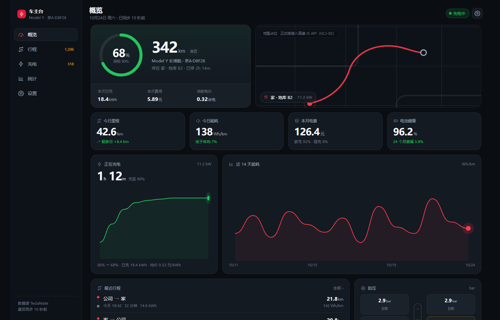
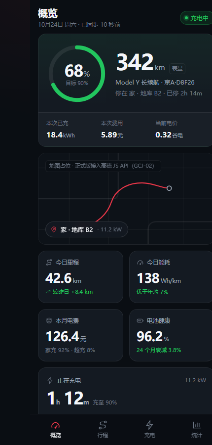

<div align="center">

# TeslaTrace

**你的车，你的数据，一眼看清。**

自托管、移动优先的 TeslaMate 数据看板。

[](#路线图)
[](LICENSE)





</div>

> ### 当前状态：早期 alpha
> 后端与前端都能跑，且是接真实 TeslaMate 数据库跑的：MQTT 实时状态、概览看板、行程列表都已可用。统计页、PWA、认证加固是下一步。
> 上面的截图来自 [`demo/`](demo/index.html) 里的原型 —— 界面就是按它实现的，浏览器打开即可看。

---

## 为什么还要一个看板

TeslaMate 已经把该记的都记了：每一个 GPS 采样点、每一趟行程、每一次充电，索引也建好了。它缺的是**一眼能看完的视图**。Grafana 是很好的分析工具，但它不是你走向车时会在手机上打开的东西。

TeslaTrace 补的是另一半：

- **一屏三个答案** —— 车在哪、还剩多少电、在不在充电。
- **数值优先于图表** —— 大号数字 + 单位 + 一句上下文；图表放下一屏，用来解释数字。
- **状态必须可解释** —— 车休眠时 TeslaMate 本就不采集。每个值都标注它多久没更新了，免得"数字冻住"被当成 bug。

## 功能

| 模块 | 内容 |
|---|---|
| 实时 | 状态胶囊（充电中 / 行驶中 / 在线 / **已休眠 42 分钟**）、电量环、续航、充电功率、预计充满、实时位置 |
| 行程 | 行程列表 + 轨迹地图、单趟能耗与电费、轨迹回放（规划中） |
| 充电 | 充电记录、SOC 曲线、分时电价计费、家充与超充占比 |
| 统计 | 日/月能耗、电池健康趋势、停放掉电（吸血鬼耗电）、对比燃油车省下的钱 |
| 平台 | 390px–1440px 全响应式、可安装 PWA、明暗双主题 |

**刻意不做**：原始电流/电压曲线、逐点 GPS 列表、车辆配置项。这些属于 Grafana 的职责。

## 架构

```
TeslaMate ──► PostgreSQL 17 ─┐
    │                        ├──► FastAPI（只读） ──► Nginx ──► 手机 / 平板 / 电脑
    └──► Mosquitto ──────────┘        │
                                      └── SSE ──► 实时状态
```

- **只读访问数据库**：独立 `teslamate_ro` 角色，只有 `SELECT`。TeslaTrace 永不改写你的 TeslaMate 数据。
- **表结构知识集中在一处**：TeslaMate 的每个字段都写在 `backend/app/sql/*.sql` 里。它升级改字段时，改一个文件就够，不用翻遍路由代码。不建视图、不做 DDL、不需要迁移步骤 —— 服务只靠 `SELECT` 运行。
- **实时走 MQTT，历史走 PostgreSQL**：不轮询车辆，不唤醒它。
- **naive UTC 只在一个地方处理**：TeslaMate 把 UTC 写进 `timestamp without time zone` 列，读取时不补时区会让整个看板偏移一个时差。这层转换在 `app/timeutil.py`，并有测试覆盖。
- **用 SSE 而不是 WebSocket**：数据只单向流动，少一个要调协议的东西。

## 环境要求

- TeslaMate **v4.x** 及其 PostgreSQL、Mosquitto
- PostgreSQL **16 或 17**
- 任意 Docker 主机 —— 在群晖 DS920+（x86_64 / 4GB 内存）上开发与验证
- TeslaTrace 容器约 **150 MB** 内存

## 快速开始

后端已经能跑。四个值，全都来自你现有的 TeslaMate compose。

```bash
git clone https://github.com/lzwanan/TeslaTrace && cd TeslaTrace/deploy
cp .env.example .env                                    # 填入 DATABASE_PASS
docker compose -f docker-compose.example.yml up -d --build
```

它会直接接入 TeslaMate 现有的 Docker 网络，所以 PostgreSQL 和 Mosquitto 都不用对外映射端口。然后：

```bash
curl localhost:8000/api/v1/summary     # 你的车，此刻
open http://localhost:8000/api/docs    # 交互式 API 文档
```

不用 Docker 直接跑：

```bash
cd backend
pip install -e ".[dev]"
DATABASE_HOST=localhost DATABASE_PASS=... MQTT_HOST=localhost python -m app
```

最后必须套 HTTPS 反代并加一层认证。**不要在无认证的情况下暴露到公网** —— 它会显示车辆的实时位置。

## 配置

| 变量 | 默认值 | 说明 |
|---|---|---|
| `DATABASE_PASS` | — | **唯一必填项**，从 TeslaMate compose 里复制 |
| `DATABASE_HOST` | `database` | TeslaMate 的服务名 |
| `DATABASE_PORT` / `DATABASE_NAME` / `DATABASE_USER` | `5432` / `teslamate` / `teslamate` | 一般不用改 |
| `MQTT_HOST` | `mosquitto` | TeslaMate 的服务名 |
| `MQTT_PORT` / `MQTT_USERNAME` / `MQTT_PASSWORD` | `1883` / — / — | broker 需要认证时才填 |
| `TZ` | `Asia/Shanghai` | 决定"今天"从几点开始 |
| `AUTH_TOKEN` | 空 | 留空即不校验，内网可用，公网绝对不行 |

就这些。没有按车配置（车辆从数据库自动发现），也没有坐标配置（存什么返回什么）。

## 接口

```
GET /healthz                  数据库与 broker 状态，供容器健康检查
GET /api/v1/cars              这个 TeslaMate 库里的所有车
GET /api/v1/live              当前状态（优先 MQTT，冷启动回退到最新位置）
GET /api/v1/summary           首页所需内容，一次请求拿全
GET /api/v1/drives?limit=20   行程列表，游标分页
GET /api/v1/stream            SSE：先一帧快照，之后每次变化推一帧
```

## 路线图

| 阶段 | 内容 | 状态 |
|---|---|---|
| P0 | 设计系统、卡片注册表、断点布局 | ✅ 原型完成 |
| P1 | FastAPI：只读库、MQTT→SSE、`/api/v1/summary`、`/drives`、健康检查 | ✅ 完成 |
| P2 | React 应用：概览、行程、卡片注册表、中英切换、明暗主题 | ✅ 完成 |
| P3 | 统计：物化视图、电池健康、停放掉电 | 🚧 下一步 |
| P4 | 认证、PWA、Docker 镜像、群晖部署文档 | ⬜ |
| P5 | 轨迹回放、多车 | ⬜ |

## 开发

两个进程，中间不需要任何配置 —— Vite 会把 `/api` 代理到后端：

```bash
# 终端 1
cd backend && pip install -e ".[dev]"
DATABASE_PASS=... python -m app          # http://localhost:8000

# 终端 2
cd frontend && npm install && npm run dev  # http://localhost:5173
```

`npm run build` 会先做类型检查再输出 `frontend/dist`，Docker 镜像把它拷进 Python 包，由 FastAPI 直接托管。

界面默认中文，顶栏一键切英文（选择会记住）。文案集中在 `frontend/src/lib/i18n.tsx`，加一门语言只是再加一本字典。

## 设计决策

[`demo/`](demo/) 里的原型是设计基线，展开说明见 [`demo/README.md`](demo/README.md)。两个关键选择：

- **用容器查询，不用媒体查询**：一张卡只知道"自己被放进了多宽的容器"，所以同一张卡能塞进侧栏、小组件、全屏，都不用改代码。
- **用卡片注册表，不写死页面**：每张卡声明各断点的 `span`、`priority` 和 `visibleWhen` 谓词。同一套卡片能长出三种首屏 —— 充电时、行驶时、停放时。

## 声明

TeslaTrace 是独立的社区项目，**与 Tesla, Inc. 无任何关联，未获其认可或赞助**。「Tesla」「TeslaMate」仅用于说明兼容性，本项目不使用任何特斯拉商标或品牌素材。

## 许可证

[MIT](LICENSE)

---

## 支持项目

TeslaTrace 免费，以后也免费。如果它帮你省下了某个订阅费，或者省掉一个折腾的周末，可以请我喝杯咖啡 —— 完全自愿，都很感谢。

<table>
  <tr>
    <td align="center" width="33%">
      <a href="docs/sponsor/wechat-pay.jpg"></a><br>
      <sub><b>微信收款</b></sub>
    </td>
    <td align="center" width="33%">
      <a href="docs/sponsor/alipay.jpg"></a><br>
      <sub><b>支付宝</b></sub>
    </td>
    <td align="center" width="33%">
      <a href="docs/sponsor/wechat-reward.jpg"></a><br>
      <sub><b>微信赞赏</b></sub>
    </td>
  </tr>
</table>

<sub>用微信或支付宝扫码，点击可查看原图。</sub>
